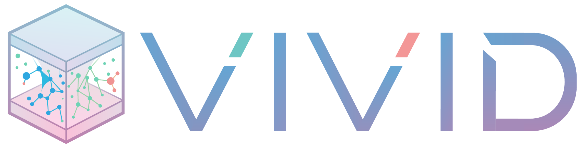
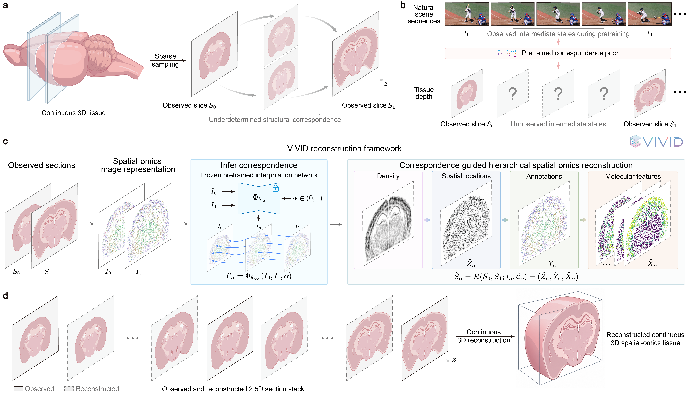

<p align="center">
  
</p>

# Reconstructing missing spatial-omics sections with video-derived correspondence priors

**VIVID** reconstructs unmeasured spatial-omics sections between two aligned observed endpoints using video-derived correspondence priors. A shared encoding of annotation identity and neighborhood composition, rendered with spatial occupancy as three-channel images, connects the endpoints to a frozen pretrained interpolation backbone. The inferred auxiliary intermediate image and target-to-endpoint correspondence fields guide hierarchical reconstruction of spatial density, coordinates, annotations and molecular profiles. VIVID supports multiple target depths and cell- or bin-resolved transcriptomic and proteomic data.

<p align="center">
  
</p>

*Figure 1. VIVID transfers video-derived correspondence priors for 3D spatial-omics reconstruction.*

## Requirements

- Linux and Python 3.10 are recommended. Use compatible PyTorch (2.0–2.5) and torchvision (0.15–0.20) versions; an NVIDIA GPU is recommended for interpolation.
- Input data in AnnData (`.h5ad`) format, with spatial coordinates in `obsm["spatial"]`, annotation labels in `obs`, and molecular measurements in `X`. Observed sections must be spatially aligned and use a shared annotation scheme. Same-modality inputs must have a common molecular feature space.
- Pretrained weights for the selected interpolation backbone (RIFE by default).
- Gurobi Optimizer and a valid license for the annotation-allocation optimization.

> **Note:** Gurobi (`gurobipy`) is commercial optimization software required by VIVID. Students, faculty and staff at eligible academic institutions can obtain a free, full-featured academic license for non-commercial research and educational use. See the [Gurobi Academic Licensing Program](https://www.gurobi.com/academics/) for details. Installing `gurobipy` alone does not activate an academic license.

## Installation

Clone the repository and install VIVID from its root directory:

```bash
git clone https://github.com/BohanSi/VIVID.git
cd VIVID

conda create -n vivid python=3.10 -y
conda activate vivid

# Install a compatible PyTorch/torchvision pair for your system if needed.
python -m pip install -e ".[tutorial,gurobi]"

# Register the Jupyter kernel.
python -m ipykernel install --user --name vivid --display-name "Python (VIVID)"
```

Alternatively, create the main environment from `environments/vivid.yml`. For GPU-specific PyTorch installation, follow the [official PyTorch instructions](https://pytorch.org/get-started/locally/).

### Gurobi license configuration

Configure a valid Gurobi license before running VIVID. Eligible academic users can request a license through the [Gurobi User Portal](https://portal.gurobi.com/) and activate it following the instructions for their license type. Academic Named-User License activation generally requires access to an academic network.

Verify Gurobi in the same Python environment used by the VIVID Jupyter kernel:

```bash
conda activate vivid

python - <<'PY'
import gurobipy as gp

with gp.Model("license_test") as model:
    x = model.addVar(vtype=gp.GRB.INTEGER, lb=0)
    model.addConstr(x >= 1)
    model.setObjective(x, gp.GRB.MINIMIZE)
    model.optimize()
    assert model.Status == gp.GRB.OPTIMAL

print("Gurobi license check passed.")
PY
```

This test verifies basic solver operation; the license must also support the problem size of the intended reconstruction.

## Pretrained interpolation models

Download the pretrained weights for the selected backbone and place them at the specified paths. **Pretrained weights are not included in this repository.**

| Backbone | Weights | Expected location |
| --- | --- | --- |
| **RIFE (default)** | [HD weights](https://drive.google.com/file/d/1APIzVeI-4ZZCEuIRE1m6WYfSCaOsi_7_/view) | `RIFE/train_log/flownet.pkl` |
| GIMM-VFI (R-P) | [Official model repository](https://huggingface.co/GSean/GIMM-VFI/tree/main) | `GIMM-VFI/pretrained_ckpt/gimmvfi_r_arb_lpips.pt` and `GIMM-VFI/pretrained_ckpt/raft-things.pth` |
| FILM (Style) | [Pretrained model folder](https://drive.google.com/drive/folders/1q8110-qp225asX3DQvZnfLfJPkCHmDpy) | `FILM/pretrained_models/film_net/Style/saved_model/` |

Keep the included inference adapters when adding pretrained weights. RIFE uses the main VIVID environment by default. GIMM-VFI and FILM require separate environments for their backend dependencies; see the [GIMM-VFI installation guide](https://github.com/GSeanCDAT/GIMM-VFI#install) and [FILM installation guide](https://github.com/google-research/frame-interpolation#installation). Specify the corresponding Python executable using `backend_python` when selecting either backend.

## Tutorial

The [VIVID Tutorial](notebooks/VIVID_tutorial.ipynb) provides a step-by-step example covering data loading, optional spatial alignment, configuration, spatial-omics image representation, correspondence inference, hierarchical reconstruction, visualization and result saving.

To analyze another dataset, replace the example input paths and adjust the configuration to match the data. See [Third-party notices](THIRD_PARTY_NOTICES.md) for attribution and license conditions of the included model code.

## Usage notes

- **Input preparation:** Provide observed sections in physical order with unique identifiers. All observed endpoints must share a common spatial coordinate system. Input loading does not modify molecular measurements; perform assay-appropriate preprocessing beforehand when needed. The optional built-in alignment is intended for single-omics data.
- **Reconstruction:** For multiple observed sections, VIVID reconstructs intermediate sections independently within each adjacent endpoint pair. `target_number` specifies the number of reconstructed sections per pair.
- **Outputs:** Reconstructed sections are saved as `.h5ad` files. For same-modality reconstruction, recovered molecular profiles are stored in `X`. For different-modality endpoints, the reconstructed sections share coordinates and annotations, while predicted modality-specific profiles are stored separately in `obsm["pred_<modality>"]`.
- **Three-dimensional representation:** Optional axial-coordinate generation uses the specified physical section thickness. For multiple adjacent endpoint pairs, the current implementation generates z coordinates in pair-local reference frames; merging them into one continuous 3D volume requires a consistent global depth reference.

## Contact

Please do not hesitate to contact **Mr. Bo-Han Si** ([sibohan@mails.ccnu.edu.cn](mailto:sibohan@mails.ccnu.edu.cn)) or **Dr. Xiao-Fei Zhang** ([zhangxf@ccnu.edu.cn](mailto:zhangxf@ccnu.edu.cn)) to seek any clarifications regarding any contents or operation of the archive.
